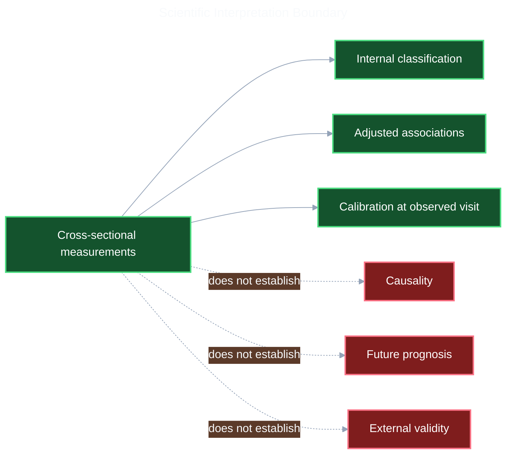
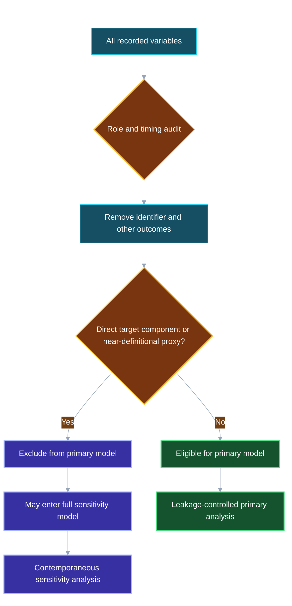
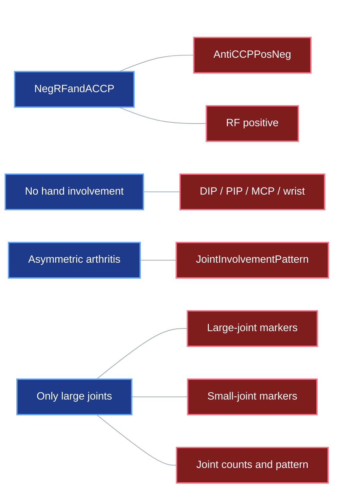
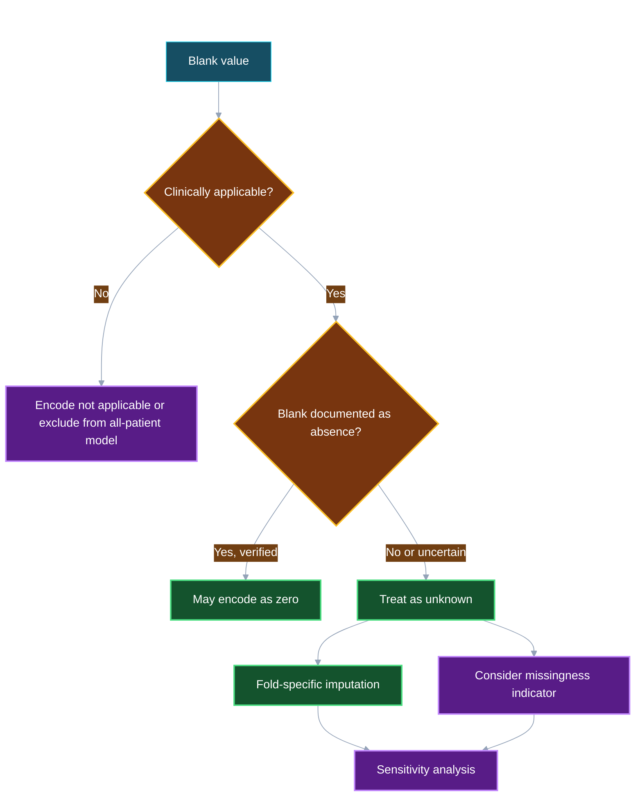
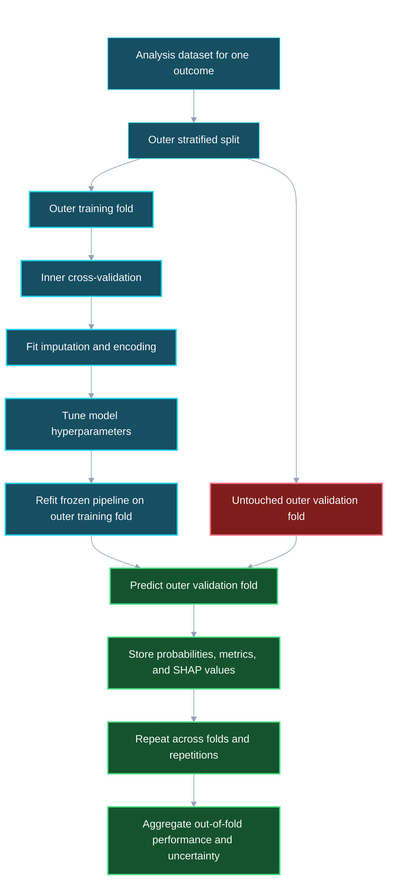
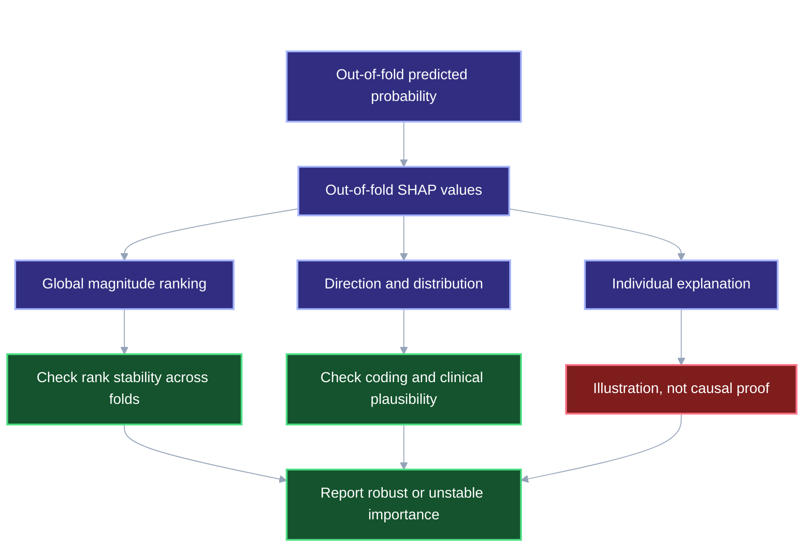
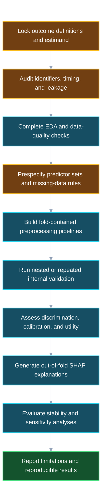

# Methodological and Practical Considerations for the Atypical RA Prediction Project

**Dataset:** `Atypical_presentations_RA_predictors_valid_c_exclusions_final_population.csv`  
**Design:** Cross-sectional clinical dataset  
**Observed sample:** 820 unique subjects, 95 columns  
**Primary targets:** `NegRFandACCP`, `NoHandJointInvolvement`, `AsymmetricArthritis`, and `OnlyLargeJoints`

> This document is a project roadmap and risk register. Except for the verified intake facts explicitly shown, it does not present completed exploratory or modeling results. Each later result must be produced by reproducible code and validated before being reported.

---

## 1. The central scientific question must be stated precisely

The practical question is whether measured clinical and paraclinical features can identify an RA patient who has one of four atypical presentations. The four outcomes represent different phenotypes and must be treated as **four separate binary classification problems**:

1. Seronegative RA: `NegRFandACCP`
2. No hand-joint involvement: `NoHandJointInvolvement`
3. Asymmetric arthritis: `AsymmetricArthritis`
4. Only large-joint involvement: `OnlyLargeJoints`

Do not combine them into one “any atypical presentation” target for the primary analysis. A composite would mix biologically and clinically different phenotypes, hide non-overlap, and make feature interpretation unclear. A composite can be explored later only as a clearly labeled secondary analysis.

### Cross-sectional limitation

Because predictors and outcomes were measured cross-sectionally, the project primarily evaluates:

- contemporaneous classification;
- adjusted associations;
- internal predictive discrimination and calibration.

It cannot by itself establish:

- temporal precedence;
- causality;
- future risk or prognosis;
- treatment effects;
- transportability to another hospital or population.

Unless a variable was demonstrably measured before outcome ascertainment, manuscript language should use phrases such as **“associated with,” “classified,”** or **“predicted at the observed visit,”** rather than implying that it caused or prospectively predicted the phenotype.



---

## 2. Verified dataset facts that affect the design

### 2.1 Size and structure

- The CSV contains **820 rows and 95 columns**, not 94 columns.
- `VisitID` is unique for all 820 rows.
- No exact duplicate rows were found at intake.
- Most binary variables are imported as `float64` because CSV numeric fields can contain missing values. Their storage type does not make them continuous variables.
- Seven columns are imported as categorical text: `RAOnset`, `Gender`, `PhysicalActivity`, `BloodGroup`, `BloodRH`, `PolyarticularType`, and `JointInvolvementPattern`.

### 2.2 Outcome balance

| Outcome | Positive | Negative | Missing | Positive prevalence |
|---|---:|---:|---:|---:|
| `NegRFandACCP` | 164 | 656 | 0 | 20.0% |
| `NoHandJointInvolvement` | 191 | 629 | 0 | 23.3% |
| `AsymmetricArthritis` | 190 | 630 | 0 | 23.2% |
| `OnlyLargeJoints` | 31 | 788 | 1 | 3.8% among all rows |

The first three outcomes are moderately imbalanced. `OnlyLargeJoints` is **severely imbalanced**, and its effective sample size is governed by only 31 positive events. The one missing outcome must be excluded only from that outcome’s analysis.

### Why event count matters more than total sample size

A model for `OnlyLargeJoints` does not effectively have 819 informative observations for estimating the rare class. In five-fold cross-validation, each validation fold will contain only about six positive cases, and each training fold about 25. Performance estimates, calibration, selected features, and SHAP rankings may vary substantially across folds.

Consequences include:

- restrict model complexity;
- avoid deep trees, large interaction searches, and aggressive tuning;
- report uncertainty prominently;
- do not claim stable individualized prediction if confidence intervals are wide;
- consider the rare outcome exploratory if model stability is inadequate.

---

## 3. Define the intended model before choosing predictors

Two distinct modeling goals should be kept separate.

### 3.1 Leakage-controlled primary model

This model asks whether non-definitional clinical and paraclinical variables can classify the phenotype. It excludes identifiers, other outcomes, and variables that directly define or nearly define the target.

This is the preferred model for clinical interpretation and journal reporting.

### 3.2 Full contemporaneous sensitivity model

This model can include a broader set of measurements that are available at the same visit, including strong phenotype proxies. It answers a narrower operational question: how well can the recorded variables reconstruct the recorded phenotype?

It may show better performance, but that performance may be tautological. It must not replace the leakage-controlled primary model.



---

## 4. Identifier, constant fields, and possible data-collection artifacts

### 4.1 `VisitID`

`VisitID` is an identifier and must never be a model predictor. An algorithm can exploit numeric ID patterns that reflect recruitment date, hospital workflow, batches, or changes in data collection.

At intake, `VisitID` showed nontrivial unadjusted associations with several outcomes. This does **not** make it a valid predictor. Instead, it is a red flag to investigate whether:

- IDs were assigned chronologically;
- outcome prevalence changed over recruitment time;
- laboratory availability changed by batch;
- data came from multiple clinics or phases;
- exclusions or coding practices changed during collection.

If recruitment date, center, or cohort wave exists outside the CSV, it should be considered for grouped or temporal validation and for describing the sampling process.

### 4.2 No-variation fields

These fields have only one observed nonmissing value:

- `NowPregnant`: all observed values are 0;
- `Cancer`: all observed values are 0;
- `NotCurrentlyClassifiableasRA2010`: all observed values are 0.

They cannot help model estimation and should be excluded. Their missing values must not be interpreted as positive cases. Their presence may indicate that the CSV already represents a post-exclusion population.

### 4.3 Near-constant variables

Other rare binary variables may technically vary but still be unusable. During EDA, tabulate the number of positive, negative, and missing values for every binary predictor. A variable with only a few positive observations can cause:

- separation in logistic regression;
- unstable odds ratios;
- arbitrary tree splits;
- unstable SHAP values;
- disclosure concerns in small subgroups.

A transparent rarity threshold should be prespecified. Do not choose a threshold based on which variables produce desirable results.

---

## 5. Target-specific leakage and tautology

### 5.1 Seronegativity model

For `NegRFandACCP`, the following are direct or near-direct components:

- `AntiCCPPosNeg`
- `SerumRheumatoidFactorPositive`

Among subjects with both source measurements available, the simple rule “anti-CCP negative and RF negative” agreed with `NegRFandACCP` approximately 98.2% of the time. The disagreement must be audited before publication. Possible explanations include timing differences, alternative cutoffs, coding errors, or outcome construction from a different measurement.

These two variables must be excluded from the primary seronegativity model. Including them would ask the model to predict a definition from the variables used to create that definition.

### 5.2 No-hand-involvement model

Potential direct components include:

- `DIPInvolvementBinary`
- `HandPIPInvolvementBinary`
- `MCPInvolvementB`
- `WristInvolvementBinary`

These should be excluded from the primary `NoHandJointInvolvement` model. Their simple combination did not reproduce the target perfectly at intake, which suggests that the outcome may include other hand joints, a different observation time, or additional clinical rules. That discrepancy requires a data-dictionary review; it does not remove the leakage concern.

### 5.3 Asymmetric-arthritis model

`JointInvolvementPattern` contains categories such as “Asymmetrical Polyarticular” and is therefore a strong proxy or potential definition component of `AsymmetricArthritis`. It should be excluded from the primary model.

Individual joint markers and joint counts may also encode the current distribution. The team must distinguish:

- a previous or baseline feature that legitimately precedes the outcome;
- a concurrent manifestation of the same phenotype;
- a variable used directly to derive the outcome.

### 5.4 Only-large-joints model

This outcome is especially vulnerable to tautology because it can be reconstructed from the presence of large-joint involvement and absence of small-joint involvement. Potential direct components or near-proxies include:

- ankle, knee, elbow, and shoulder markers;
- MTP and PIP-foot markers;
- DIP, hand PIP, MCP, and wrist markers;
- joint counts;
- `JointInvolvementPattern`;
- possibly `NoHandJointInvolvement`.

All other atypical outcomes must be excluded as predictors in every primary model, even if they are clinically associated.



---

## 6. Outcome quality and label verification

Before modeling, create a written definition for each outcome that specifies:

- clinical definition;
- source variables;
- thresholds;
- observation time;
- how missing source measurements were handled;
- who assigned the label;
- whether adjudication or repeat review occurred.

Check every outcome against its likely source variables. Disagreements should be listed and resolved with domain experts rather than automatically overwritten.

Also verify that 1 consistently means “atypical phenotype present” and 0 means absent. Inspect all unique values and do not rely on column names alone.

Label error places an upper limit on model performance. If the target itself is derived inconsistently, more sophisticated algorithms will not correct the underlying problem.

---

## 7. Missing data require clinical interpretation

The selected working assumption is that blank binary values mean **unknown or not assessed**, not “no.” This prevents systematic conversion of unrecorded disease into absence.

### 7.1 Distinguish three kinds of missingness

1. **True unknown:** a measurement could have been made but was not available.
2. **Structural non-applicability:** pregnancy-related fields in men or some women.
3. **Workflow missingness:** a laboratory or form was used only in a subset or collection period.

These mechanisms have different meanings and should not be handled identically.

### 7.2 Variables already known to have substantial missingness

Examples identified at intake include:

- `PregnancyAgeOf1thPregnancy`: 533 missing;
- `TyG`: 287 missing;
- `BloodRH`: 279 missing;
- `DLPObj`: 270 missing;
- `BloodGroup`: 270 missing;
- `AntiCCPPosNeg`: 195 missing;
- several hematologic fields: approximately 149–184 missing.

These numbers must be formally summarized during EDA. Missingness should also be compared by outcome class, gender, age, and—if available—recruitment phase.

### 7.3 Primary imputation strategy

For a robust reproducible baseline:

- impute numeric variables with the training-fold median;
- impute nominal variables with an explicit `Unknown` category or training-fold mode, depending on clinical meaning;
- add missingness indicators where missingness may be informative;
- perform every imputation step **inside each training fold**;
- fit the imputer only on the training data and apply it unchanged to validation data.

A multivariable imputation method can be used as a sensitivity analysis, but it must also respect the resampling structure. Imputing the full dataset before cross-validation leaks information from validation folds into training.

### 7.4 High-missingness variables

Do not use one automatic percentage cutoff without clinical review. For each highly missing variable, consider:

- clinical importance;
- whether missingness is structural;
- whether it is available in intended real-world use;
- number of observed positive and negative outcomes;
- stability across imputation strategies.

A variable such as `TyG` may be biologically interesting but operationally unsuitable if it is absent for a large, systematically selected subset.



---

## 8. Sex-specific and reproductive variables

The confirmed primary strategy is to exclude reproductive variables from all-patient models and consider them in a female-only sensitivity analysis:

- `Menopause`
- `PregnancyHistory`
- `NoOfPregnancy`
- `PregnancyAgeOf1thPregnancy`
- `FetalLoss`
- `ContraceptionMethodOCP`
- `ContraceptionMethodIUD`
- `PrematureInfants`

Reasons:

- many values are structurally inapplicable to men;
- zero can mean “no,” “not applicable,” or “not recorded”;
- interactions with age and gender are likely;
- sparse combinations can cause overfitting;
- interpretation in a mixed-sex model is difficult.

For female-only analyses, verify applicability carefully. For example, age at first pregnancy should not be imputed as a typical age for a woman who was never pregnant. “Never pregnant,” “unknown,” and a measured age are distinct states.

`Menopause` needs a special coding audit because it has no missing values even though men are present. If men are coded as 0, this should not be interpreted as clinically equivalent to premenopausal women.

---

## 9. Exploratory data analysis requirements

EDA should be descriptive and diagnostic, not a hidden feature-selection exercise.

### 9.1 Data integrity

Check:

- legal values and units;
- impossible ages or durations;
- negative values where impossible;
- impossible counts;
- `RADurationDays` relative to age;
- ranges for patient global assessment and grip strength;
- duplicated or logically inconsistent fields;
- hidden strings, decimal artifacts, and alternative missing codes;
- whether zero is physiologically valid or a missing placeholder.

### 9.2 Distributions

For continuous/count variables, report:

- count, mean, SD, median, IQR, minimum, and maximum;
- histograms or density plots;
- boxplots stratified by outcome;
- clinically meaningful transformations where justified.

`RADurationDays` is likely right-skewed and may need `log1p` transformation or spline modeling. Do not winsorize or remove values solely because they are statistically extreme; first determine whether they are plausible.

### 9.3 Class balance

For each outcome, show counts and percentages, not percentages alone. Report the number of positive cases after every analysis-specific exclusion.

### 9.4 Missingness

Produce:

- missing count and percentage by variable;
- missingness heatmap or matrix;
- co-missingness patterns;
- comparison of missingness by outcome class;
- comparison by gender and potential recruitment phase.

### 9.5 Correlation and redundancy

Use appropriate association measures:

- Spearman correlation for continuous/ordinal variables;
- phi coefficient for binary pairs;
- Cramér’s V for categorical pairs;
- point-biserial or rank-based measures for binary–continuous pairs.

Important expected redundancies include:

- right and left grip strength;
- tender and swollen joint counts;
- joint-pattern categories and individual joint markers;
- obesity and metabolic markers;
- related comorbidities;
- serology variables and seronegative outcome.

Correlation does not automatically justify dropping a variable. Decisions should consider clinical meaning, stability, and model requirements. For linear models, high collinearity destabilizes individual coefficients even when overall prediction remains acceptable.

### 9.6 Subgroup counts

Cross-tabulate outcomes by gender, age groups, and relevant comorbidities. Sparse cells should be flagged before fitting interactions or subgroup models.

---

## 10. Preprocessing must be inside the validation pipeline

The correct order within each resampling split is:

1. separate training and validation observations;
2. learn missing-data rules from training data;
3. learn category levels and encoding from training data;
4. learn scaling parameters from training data;
5. perform any feature selection using training data only;
6. tune the model using inner resampling when tuning is required;
7. apply the frozen pipeline to the outer validation fold.

Any supervised feature selection, imputation, scaling, or oversampling performed before splitting causes optimistic bias.

### Encoding

- Binary 0/1 variables can remain binary after missing-data handling.
- Nominal variables such as `BloodGroup` require one-hot encoding.
- Ordered categories such as physical activity may be ordinal only if the assumed order and spacing are clinically defensible.
- Unseen categories in validation data must be handled safely.

### Scaling

Standardize continuous variables for penalized linear models. Scaling is not generally required by tree models, but a single consistent preprocessing architecture can reduce implementation errors.

### Nonlinearity

Continuous effects should not automatically be assumed linear. Restricted cubic splines are clinically interpretable but consume degrees of freedom. Given the event counts, nonlinear terms should be limited and prespecified, especially for `OnlyLargeJoints`.

---

## 11. Model choices suitable for this dataset

### 11.1 Recommended primary model

A regularized logistic regression is a strong primary choice because it:

- is appropriate for binary outcomes;
- works with many correlated predictors;
- limits coefficient magnitude;
- is more interpretable than complex ensembles;
- can produce calibrated probabilities;
- provides a transparent benchmark for SHAP and coefficient interpretation.

Elastic-net regularization can combine ridge stabilization with sparse selection. Hyperparameters must be tuned within inner cross-validation.

For extremely sparse outcomes or separation, consider ridge logistic regression or a carefully justified bias-reduced logistic approach. Lasso selection alone may be unstable when predictors are correlated.

### 11.2 Secondary models

Potential secondary comparators include:

- a simple clinical baseline model;
- ridge logistic regression;
- elastic-net logistic regression;
- shallow gradient-boosted trees with tightly constrained complexity;
- possibly a constrained random forest, interpreted cautiously.

Do not compare a large model zoo. Trying many algorithms and reporting only the best creates another layer of overfitting.

### 11.3 What to avoid

- deep neural networks;
- unrestricted tree depth;
- exhaustive interaction searches;
- univariable p-value screening before multivariable modeling;
- stepwise regression as the main feature-selection method;
- choosing features on the full dataset;
- selecting the final model based only on the largest cross-validated AUROC.

---

## 12. Class imbalance strategy

### 12.1 Do not use accuracy as the main metric

For `OnlyLargeJoints`, a model predicting every patient as negative would be about 96% accurate while detecting no positive cases.

### 12.2 Preferred handling

- use stratified resampling;
- consider class-weighted loss inside training folds;
- evaluate precision–recall performance;
- report sensitivity and specificity with uncertainty;
- choose thresholds based on a prespecified clinical objective;
- retain unaltered validation-fold prevalence.

### 12.3 Oversampling and SMOTE

Synthetic oversampling is not recommended as the primary strategy here. With only 31 positive `OnlyLargeJoints` cases and mixed clinical variables, synthetic examples may be unrealistic and can increase instability. If evaluated, oversampling must occur only in training folds and should be a sensitivity analysis.

### 12.4 Probability correction

Class weighting or resampling can alter the effective training prevalence and distort raw predicted probabilities. Calibration must therefore be evaluated on validation data with the natural prevalence.

---

## 13. Validation design

A single train/test split would waste information and produce unstable conclusions. Internal validation should use repeated stratified resampling or nested cross-validation.

### Recommended framework

- **Outer loop:** estimates unbiased generalization performance.
- **Inner loop:** tunes regularization and other hyperparameters.
- **All preprocessing:** fitted inside the relevant training fold.
- **Repetition:** used to quantify split-to-split variability.
- **Fixed seeds:** recorded for exact computational reproduction.

For the rare outcome, five outer folds are already demanding because each validation fold has only about six events. More folds do not automatically improve rigor; ten folds would leave only about three positive validation cases per fold.



### Bootstrap alternative

Bootstrap optimism correction is useful for a prespecified low-complexity model and may be more efficient than a held-out test set. It does not eliminate the need to place the entire modeling process—including selection and tuning—inside each bootstrap replicate.

### No external validation

Without an independent cohort, the study can claim only internal validation. External validation should be explicitly identified as future work, not implied by cross-validation.

---

## 14. Performance metrics to report

For every outcome and model, report:

### Discrimination

- AUROC with confidence interval;
- area under the precision–recall curve;
- prevalence or no-skill PR baseline.

### Calibration

- calibration plot;
- calibration intercept;
- calibration slope;
- Brier score;
- optionally log loss.

Calibration statistics for `OnlyLargeJoints` will be imprecise because of the low event count. Show the uncertainty rather than overinterpreting the curve.

### Threshold-dependent utility

At clinically prespecified thresholds, report:

- sensitivity;
- specificity;
- positive predictive value;
- negative predictive value;
- balanced accuracy;
- confusion matrix with counts.

Predictive values depend strongly on prevalence and may change in another setting.

### Clinical usefulness

Decision-curve analysis can be considered if a real clinical action and plausible threshold range can be specified. It should not be added merely as a decorative plot.

### Model comparison

Compare models using paired out-of-fold predictions where possible. Small numerical differences should not be called meaningful unless uncertainty and clinical relevance support the claim.

---

## 15. SHAP analysis: correct use and limitations

SHAP can explain model predictions, but it does not establish causal importance.

### 15.1 Use out-of-fold explanations

Primary SHAP summaries should be generated for observations when they are in an outer validation fold, using the model that did not train on those observations. Explanations from a model evaluated on its own training data can exaggerate importance.

### 15.2 Required outputs

For each outcome:

- global mean absolute SHAP ranking;
- beeswarm plot showing direction and distribution;
- dependence plots for a small number of clinically relevant features;
- patient-level waterfall plots only as illustrative examples;
- stability of feature ranks across folds or bootstrap samples.

### 15.3 Direction of effect

A positive SHAP value should be explicitly defined as moving the prediction toward outcome = 1. The reference category for one-hot-encoded variables must be reported.

### 15.4 Correlated predictors

SHAP credit can be divided or reassigned among correlated variables. For example, left and right grip strength may substitute for each other across folds. A low SHAP rank does not prove that a correlated feature is unimportant.

Where categories are one-hot encoded, aggregate their SHAP magnitudes back to the original clinical variable for the primary ranking. Otherwise variables with more encoded levels can receive disproportionate attention.

### 15.5 Stability over visual appeal

A striking SHAP plot from one fitted model is not enough. Report whether the leading features remain important across resamples. If rankings are unstable, state that directly.



---

## 16. Statistical inference and multiple outcomes

The project has four primary prediction problems. This creates multiplicity in:

- performance comparisons;
- coefficient interpretation;
- subgroup analyses;
- SHAP feature rankings;
- any conventional hypothesis tests.

Prediction modeling does not require p-value correction for every descriptive step, but inferential claims must be controlled. If many coefficients or associations are tested, prespecify primary hypotheses and consider false-discovery-rate control.

Do not describe a feature as a universal atypical-RA predictor merely because it appears in one model. Compare direction, uncertainty, and stability separately across the four outcomes.

If odds ratios are reported, remember:

- penalized estimates are shrunk;
- odds ratios are not risk ratios;
- cross-sectional odds do not establish incidence risk;
- coefficients can change with correlated covariates and coding choices.

---

## 17. Confounding, mediation, and clinical plausibility

A prediction model is not automatically a causal model. Some variables may be:

- confounders;
- consequences of the phenotype;
- mediators;
- treatment-related measurements;
- components of diagnostic workup;
- proxies for healthcare access or recording intensity.

For example, joint counts and patient global assessment may reflect the same current disease episode as the outcome. Comorbidities may correlate with age and obesity. Laboratory availability may reflect clinician suspicion.

Before interpreting a feature biologically, ask:

1. Was it measured before, during, or after phenotype ascertainment?
2. Could the outcome influence the predictor?
3. Could measurement be ordered because clinicians suspected the outcome?
4. Is the feature part of the diagnostic definition?
5. Is the association robust to age, gender, duration, and missingness strategy?

Clinical plausibility supports interpretation but does not replace validation.

---

## 18. Sensitivity analyses worth prespecifying

A manageable set of high-value sensitivity analyses includes:

1. leakage-controlled versus expanded contemporaneous predictor sets;
2. simple fold-specific imputation versus multivariable imputation;
3. models with and without missingness indicators;
4. unweighted versus class-weighted loss;
5. female-only reproductive-variable analysis, if events permit;
6. models with and without high-missingness laboratory variables;
7. logistic regression versus one constrained nonlinear model;
8. alternate handling of rare categories;
9. exclusion or audit of cases with inconsistent outcome-source coding;
10. bootstrap stability assessment for feature importance.

Do not create dozens of post hoc analyses. Prespecification makes sensitivity findings more credible.

---

## 19. Reproducibility requirements

The final code should run end-to-end from the unchanged source CSV and produce all tables, figures, models, and explanations.

Record:

- exact input filename and checksum;
- Python and package versions;
- random seeds;
- outcome definitions;
- inclusion and exclusion counts;
- predictor lists for every outcome;
- preprocessing steps;
- resampling splits or saved split indices;
- tuned hyperparameters;
- final metrics with confidence intervals;
- generated figure and table paths.

Recommended project structure:

```text
ra_analysis/
├── README.md
├── config.yaml
├── data_dictionary.csv
├── column_inventory.csv
├── project_considerations.md
├── src/
│   ├── data_validation.py
│   ├── eda.py
│   ├── preprocessing.py
│   ├── modeling.py
│   ├── evaluation.py
│   └── explainability.py
├── reports/
│   ├── figures/
│   └── tables/
├── models/
├── requirements.txt or environment.yml
└── run_analysis.py
```

Do not manually edit intermediate analysis files. Derived datasets and figures should be reproducible from code.

---

## 20. Reporting standards and manuscript transparency

Consult prediction-model reporting and risk-of-bias guidance applicable at submission, including **TRIPOD+AI** and **PROBAST/PROBAST+AI**, as required by the target journal.

The manuscript should clearly report:

- study setting and dates;
- eligibility criteria and exclusions;
- how RA and each atypical phenotype were defined;
- sample-size rationale;
- event counts for all outcomes;
- missing-data handling;
- complete predictor definitions and measurement timing;
- model specification and hyperparameter tuning;
- internal validation design;
- all performance measures with uncertainty;
- calibration, not only discrimination;
- how SHAP was calculated and validated;
- deviations from the prespecified plan;
- lack of external validation;
- data/code availability and ethical approvals.

A Q1-journal submission is strengthened more by transparent limitations and leakage-safe validation than by a complex algorithm with a high apparent AUROC.

---

## 21. Recommended decision hierarchy

When methodological choices conflict, use this order:

1. protect the clinical meaning of the outcome;
2. prevent target and validation leakage;
3. preserve honest uncertainty;
4. favor simpler models compatible with event counts;
5. evaluate calibration and clinical usefulness;
6. assess explanation stability;
7. pursue marginal performance improvements last.



---

## 22. Project-specific red-flag checklist

Before claiming a model is ready, confirm all of the following:

- [ ] The 95-versus-94 column discrepancy is explained.
- [ ] A clinical data dictionary is available.
- [ ] Each outcome definition and source-variable rule is documented.
- [ ] Serology/outcome disagreements are reviewed.
- [ ] Joint-marker/outcome disagreements are reviewed.
- [ ] `VisitID` is excluded and its association with outcomes is investigated as a possible batch/time artifact.
- [ ] All other outcome columns are excluded from each target model.
- [ ] Target-specific definitional variables are excluded from primary models.
- [ ] Missing does not silently become “no.”
- [ ] Structural missingness is separated from unknown values.
- [ ] Sex-specific variables are excluded from primary all-patient models.
- [ ] Rare and near-constant predictors are identified before modeling.
- [ ] All preprocessing and feature selection occur inside resampling.
- [ ] The rare `OnlyLargeJoints` outcome is modeled conservatively.
- [ ] Accuracy is not used as the primary imbalance metric.
- [ ] Calibration and PR-AUC are reported with AUROC.
- [ ] SHAP is calculated out-of-fold and interpreted non-causally.
- [ ] Feature-importance stability is reported.
- [ ] Confidence intervals or resampling distributions accompany performance estimates.
- [ ] No claim of external validity is made without an independent cohort.
- [ ] The complete analysis is reproducible from the original CSV.

---

## 23. Immediate next steps

1. Obtain or construct a clinical data dictionary with units, coding rules, and measurement timing.
2. Resolve the outcome construction discrepancies before model fitting.
3. Complete Stage 1 EDA with outcome-specific summaries and missingness analysis.
4. Freeze target-specific primary and sensitivity predictor lists.
5. Prespecify validation, metrics, imputation, and sensitivity analyses.
6. Only then begin model training.

**Current status:** dataset intake and role confirmation are complete. Formal Stage 1 EDA and all subsequent modeling remain to be performed.
